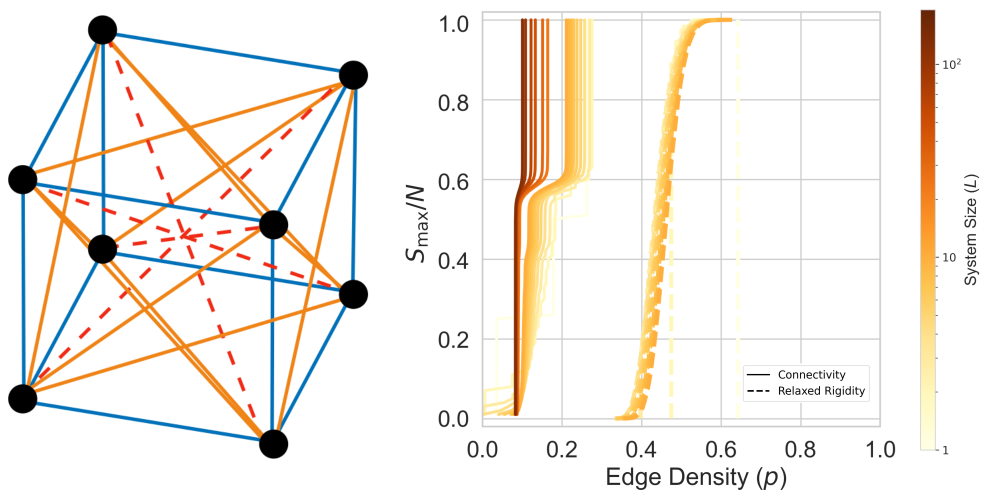

# Explosive Connectivity and Mechanical Rigidity in Cubic Lattice Structures



This repository contains the complete source code and analysis pipeline for the explosive Connectivity and mechanical rigidity in cubic lattice structures.

The repository includes two main Python scripts:
1.  `run_campaign.py`: A high-performance script to run the full simulation campaign from scratch. It is designed for parallel execution on multiple machines and can resume interrupted campaigns.
2.  `analyze_campaign.py`: A script to process the raw simulation data, perform all statistical analyses, and generate the figures presented in the paper.

## Repository Structure

```markdown

```.
├── run_campaign.py           # Script to generate raw simulation data
├── analyze_campaign.py       # Script to analyze data and generate plots
├── README.md                 # This file
├── requirements.txt          # Python dependencies
└── FULL_CAMPAIGN_L1-10/      # (Generated by run_campaign.py)
    └── machine_0/
        ├── L1_k1_..._run0.json
        └── ...
└── cache/                      # (Generated by analyze_campaign.py)
    ├── agg_L1_k1_... .pkl
    └── ...
└── plots/                      # (Generated by analyze_campaign.py)
    ├── NNShell1_k2_..._OrderParam.png
    └── ...
```

## Dependencies and Installation

The analysis script requires several Python packages. All dependencies are listed in the `requirements.txt` file.

1.  **Clone the repository:**
    ```bash
    git clone <your-repository-url>
    cd <your-repository-name>
    ```

2.  **Install the required packages:**
    It is strongly recommended to use a virtual environment.
    ```bash
    python -m venv venv
    source venv/bin/activate  # On Windows, use `venv\Scripts\activate`
    pip install -r requirements.txt
    ```

## Running the Simulations

The following procedures will generate all simulation data from scratch. 

**Warning:** This is a very computationally intensive process that may take days or weeks depending on the hardware available.

The `run_campaign.py` script is designed to distribute the workload across multiple machines.

1.  **Run on a Single Machine:**
    To run a portion of the campaign on one machine, you must specify a unique `machine_id` and the total `num_machines`. For example, to run as the first of 20 machines:

    ```bash
    python run_campaign.py --machine_id 0 --num_machines 20
    ```

2.  **Run on Multiple Machines:**
    To run the full campaign, execute the script on each of the `num_machines`, giving each a unique ID from `0` to `num_machines - 1`. For example:
    -   On Machine 1: `python run_campaign.py --machine_id 0 --num_machines 20`
    -   On Machine 2: `python run_campaign.py --machine_id 1 --num_machines 20`
    -   ...and so on.

    The script automatically divides the total parameter space among the machines. It is also designed to be resilient; it can be stopped and restarted at any time and will automatically resume unfinished work.

3.  **Aggregate and Analyze:**
    After all simulations are complete, gather the `machine_*/` output directories from all machines into a single `FULL_CAMPAIGN_L1-10/` directory. Then, run the analysis script as as follows.

    ```bash
    python analyze_campaign.py
    ```
    This will:
    -   Create a `cache/` directory to store aggregated data, speeding up subsequent runs.
    -   Create a `plots/` directory containing all figures from the paper.
    -   Print a comprehensive statistical report to the console.


## Citation

If you use this code or data in your work, please cite our preprint:

Trenton Lau and Gary P. T. Choi, 
"[Explosive connectivity and mechanical rigidity in cubic lattice structures.](https://arxiv.org/abs/2511.01537)"
arXiv preprint arXiv:2511.01537, 2025.

```bibtex
@article{lau2025explosive,
    author    = {Lau, Trenton and Choi, Gary P. T.},
    title     = {Explosive connectivity and mechanical rigidity in cubic lattice structures},
    journal   = {arXiv preprint arXiv:2511.01537},
    year      = {2025},
    eprint    = {2511.01537},
    archivePrefix = {arXiv},
    primaryClass = {cond-mat.stat-mech}
}
```

## License

This project is licensed under the Apache-2.0 License.


Copyright (c) 2025, Trenton Lau and Gary P. T. Choi

https://github.com/garyptchoi/cubic-lattice-percolation
